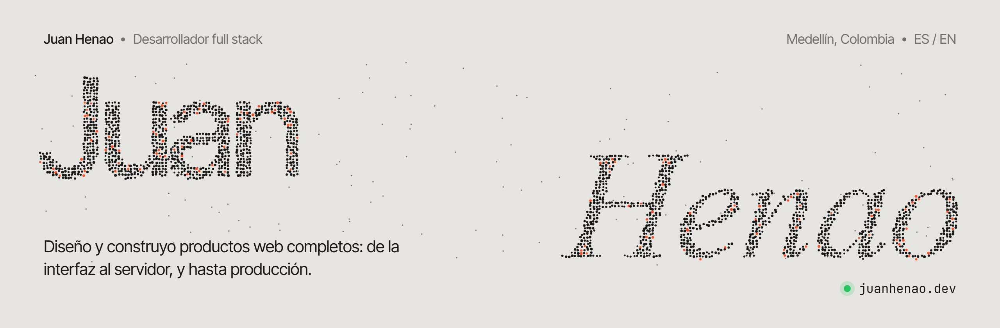
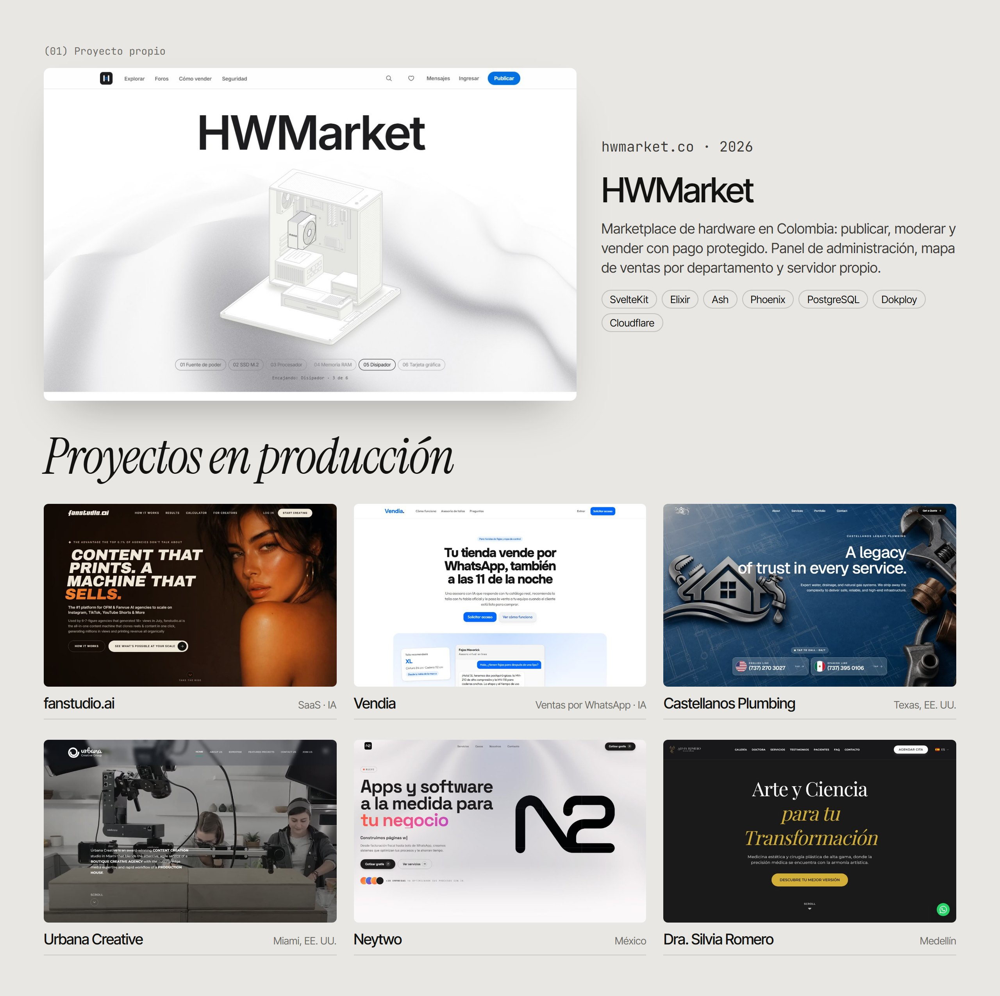

  <a href="https://juanhenao.dev"><b>juanhenao.dev</b></a> &nbsp;·&nbsp;
  <a href="https://wa.me/573216194269">WhatsApp</a> &nbsp;·&nbsp;
  <a href="mailto:santamariajuan34@gmail.com">santamariajuan34@gmail.com</a>

 

Desarrollador full stack en **Medellín, Colombia**. Diseño y construyo productos web completos: interfaz, backend, base de datos y despliegue, hasta que están en producción y alguien los usa.

*Full stack developer based in Medellín. I work in Spanish and English.*

 

### Ahora mismo

- **[hwmarket.co](https://hwmarket.co)**: marketplace de hardware para Colombia. SvelteKit + Elixir/Ash, pagos con comisión e IVA calculados al peso, panel de administración con 2FA y un servidor propio con Dokploy y Cloudflare Tunnel.
- **[juanhenao.dev](https://juanhenao.dev)**: mi portafolio. Mi nombre en 16.000 partículas WebGL que se reorganizan para formar cada proyecto.

 

 

| Proyecto | Qué es | Stack |
|---|---|---|
| [hwmarket.co](https://hwmarket.co) | Marketplace de hardware en Colombia | SvelteKit · Elixir · Ash · PostgreSQL |
| [fanstudio.ai](https://fanstudio.ai) | SaaS de contenido con IA para agencias | Next.js · Clerk · PostHog · Cloudflare |
| [Vendia](https://app.vendia.mydanksecretapp.xyz) | Asesora de ventas con IA en WhatsApp | SvelteKit · Elixir · Phoenix |
| [Castellanos Plumbing](https://castellanosplumbing.com) | Sitio bilingüe, Texas | Astro · React · Keystatic · Supabase |
| [Urbana Creative](https://urbanacreative.com) | Estudio de contenido, Miami | Next.js · GSAP · Resend |
| [Neytwo](https://neytwo.com/es) | Software a la medida, México | Next.js · Three.js · Lenis |
| [Dra. Silvia Romero](https://drasilviaromero.com) | Landing bilingüe de salud, Medellín | Next.js · GSAP |

 

### Con qué construyo

  
   
  
   
  

 

  ¿Tienes un proyecto? <a href="https://wa.me/573216194269">Escríbeme</a> · Hora en Medellín: UTC−5

